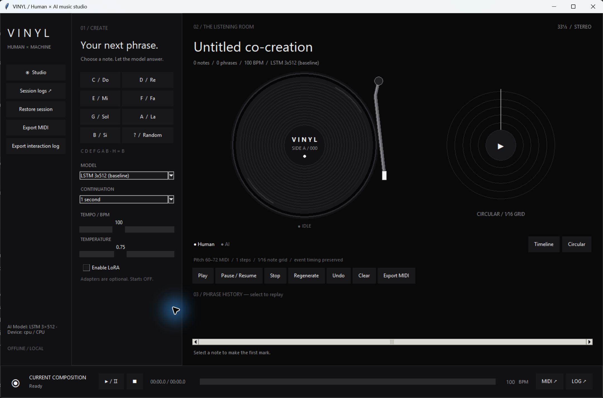

# Vinyl Studio

A desktop app for human-AI music co-creation. Choose a note and hear a trained LSTM generate a short continuation. Replay, regenerate and export your composition as MIDI.



## Run

Use **Windows 10 or 11 with 64-bit Python 3.11 or newer**, including Tcl/Tk. Python from python.org includes Tcl/Tk in its standard Windows installation.

Clone this repository, open its folder, and run:

```powershell
python main.py
```

You can also double-click `main.py` when Windows associates `.py` files with Python.

On the first launch, a setup window automatically installs PyTorch and MIDI support into a private `.venv` folder if your current Python needs them. Keep an internet connection available until setup finishes. Later launches work offline. If setup is interrupted, run `main.py` again to retry. Details are saved in the local `setup.log`.

Both trained models are included in `models/runtime/` (about 96 MB combined). A GPU is optional. Playback uses the Windows MIDI synthesizer, with a local tone fallback.

## Use

- Click C, D, E, F, G, A or B to generate a phrase. The matching keyboard keys work too.
- Open **Generation Settings** to choose the model, response duration, tempo and temperature.
- Switch between circular and timeline views. Click a phrase card to replay it.
- Use **Regenerate**, **Undo**, playback controls and the seek bar to refine the composition.
- Export MIDI or a session log. **Restore session** opens a saved interaction log.

LoRA starts OFF. If you have a compatible adapter, enable LoRA, choose **Browse**, and apply its `.pt` file. Adapters are optional and are supplied separately. The compact models retain compatibility with adapters for their original training checkpoints.

## Included models

| Model | Architecture | Inference file |
| --- | --- | --- |
| Baseline | 3 LSTM layers, 512 hidden units | approximately 24 MB |
| Experimental | 4 LSTM layers, 768 hidden units | approximately 72 MB |

The inference files preserve every trained tensor and the model configuration. Optimizer and scheduler state used during training has been omitted. Random sampling means successive generated phrases can differ.

The models were trained using MIDI from the Artificial Audio Multitracks dataset. [Dataset record](https://doi.org/10.5281/zenodo.5794629)

This repository contains the application, its required Python modules, the inference models and dependency setup. Sessions, display preferences and setup files are created locally during use.
